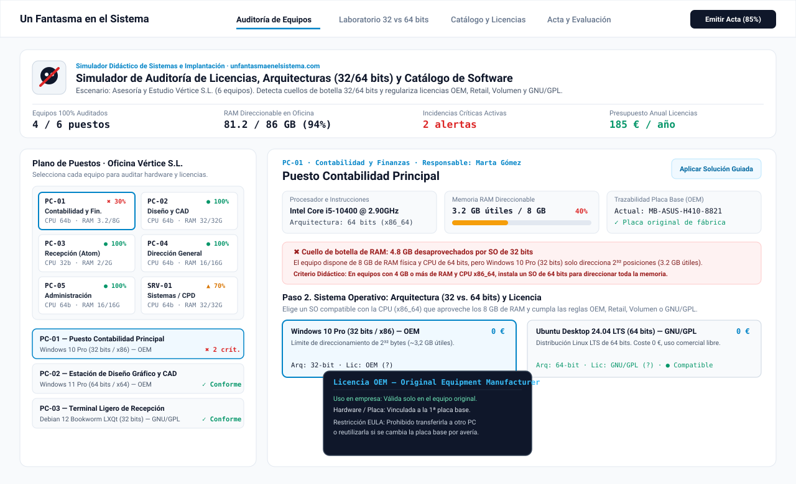
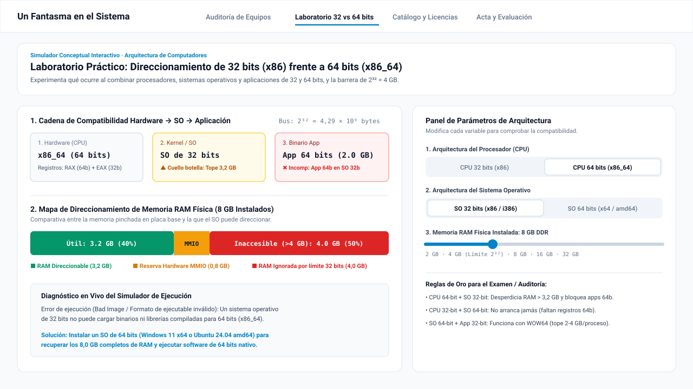
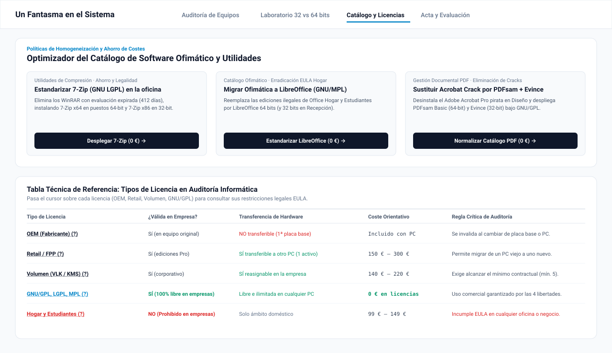
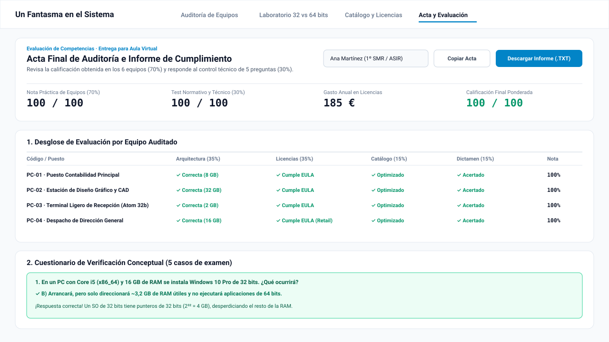

<div align="center">
  <a href="https://www.unfantasmaenelsistema.com/" target="_blank">
    
  </a>

  # Simulador de Auditoría de Licencias y Compatibilidad (32 vs. 64 bits)

  **Recurso educativo interactivo para Formación Profesional en Informática (SMR · ASIR · DAW · DAM)**  
  Desarrollado para **[Un Fantasma en el Sistema](https://www.unfantasmaenelsistema.com/)**

  [](https://react.dev/)
  [](https://www.typescriptlang.org/)
  [](https://vitejs.dev/)
  [](https://tailwindcss.com/)
  [](#despliegue-automático-en-github-pages)
</div>

---

## 📋 ¿Qué hace esta aplicación?

El **Simulador de Auditoría de Licencias y Compatibilidad** plantea un escenario realista donde el alumnado asume el rol de auditor técnico y legal en una pequeña empresa (**Asesoría y Estudio Vértice S.L.**) con un inventario heterogéneo de **6 equipos informáticos** (5 estaciones de trabajo departamentales y 1 servidor local).

### Mecánica didáctica principal

1. **Identificación de incompatibilidades de arquitectura (`32 bits / x86` vs. `64 bits / x86_64`)**:
   - Detectar cuellos de botella de direccionamiento de memoria ($2^{32} \text{ bytes} = 4\text{ GB}$ teóricos / $\sim 3,2\text{ GB}$ útiles por reserva MMIO/PCIe) cuando se instala un Sistema Operativo de 32 bits sobre hardware de 64 bits con 8 GB o más de RAM.
   - Comprender por qué una CPU física de 32 bits puros (`Intel Atom N270 i686`) no puede arrancar kernels ni ejecutar binarios de 64 bits (`x86_64`).
   - Analizar la ejecución de aplicaciones de 32 bits en sistemas de 64 bits mediante el subsistema **WOW64** y su límite de 2–4 GB de memoria por proceso en estaciones de diseño gráfico.
2. **Verificación legal de tipos de licencia (`OEM`, `Retail`, `Volumen`, `GNU/GPL`, `Hogar`, `Freeware`, `Shareware`)**:
   - **Tooltips legales interactivos** integrados en toda la interfaz para consultar al instante las restricciones del contrato EULA sin salir de la pantalla.
   - Detección de licencias **OEM** invalidadas por haberse transferido desde la placa base de un equipo antiguo desechado a un ordenador nuevo.
   - Identificación de usos comerciales no permitidos (*Microsoft Office Hogar y Estudiantes*, *TeamViewer Free* de uso personal, *WinRAR* con evaluación expirada y *cracks* piratas).
   - Validación de umbrales mínimos en contratos corporativos por **Volumen (VLK)** y despliegue legal de **Software Libre (`GNU/GPL`, `LGPL`, `AGPL`, `MPL`)** en entornos empresariales a coste $0\text{ €}$.
3. **Optimización del catálogo de software ofimático y utilidades**:
   - Homogeneización de herramientas por departamento (**Ofimática, Compresores, Gestión PDF, Diseño Gráfico, Soporte Remoto y Contabilidad/ERP**), eliminando duplicidades y software innecesario en servidores.

---

## 📸 Capturas de Pantalla de los Módulos

### 1. Plano de Puestos, Consola de Auditoría y Tooltips Legales Interactivos
> Inspección individual de los 6 equipos de la oficina, telemetría de hardware, trazabilidad de número de serie de placa base OEM, hallazgos en vivo y tooltips explicativos sobre cada licencia.



---

### 2. Laboratorio Interactivo 32 bits (`x86`) vs. 64 bits (`x86_64`)
> Simulador conceptual en tiempo real para experimentar con la cadena **CPU → Kernel SO → Aplicación**, visualizar el mapa de memoria física frente a direccionable ($2^{32}$ vs $2^{64}$) y comprobar el comportamiento del subsistema **WOW64**.



---

### 3. Optimizador del Catálogo Ofimático y Matriz Comparativa de Licencias
> Despliegue de políticas de estandarización con alternativas libres **GNU/GPL** (*LibreOffice, 7-Zip, PDFsam Basic, Evince, GIMP, Inkscape, RustDesk*) y tabla técnica de referencia para auditorías.



---

### 4. Acta Final de Auditoría, Cuestionario de Examen y Exportación (`.TXT`)
> Calificación ponderada en tiempo real (**70 % resolución práctica de los 6 equipos + 30 % cuestionario normativo de 5 preguntas de examen**) con exportación directa en `.TXT` o copiado al portapapeles para entregar en Moodle / Classroom.



---

## 🖥️ Guía del Escenario para el Docente (Los 6 Equipos de la Oficina)

| Código | Puesto / Departamento | Hardware Instalado | Anomalía Inicial en el Escenario | Solución Óptima Esperada |
| :--- | :--- | :--- | :--- | :--- |
| **PC-01** | Contabilidad Principal *(Marta Gómez)* | Intel Core i5-10400 (`x86_64`) · **8 GB RAM DDR4** | Tiene **Windows 10 Pro 32 bits OEM** (desperdicia 4,8 GB de RAM, dejando solo 3,2 GB útiles) + ERP de 64 bits que no inicia + WinRAR expirado. | Migrar SO a **64 bits** (Ubuntu 24.04 LTS GNU/GPL o Windows 11 64-bit) y normalizar catálogo en 64 bits (LibreOffice, GnuCash/ContaPyme x64, 7-Zip, PDFsam). |
| **PC-02** | Estación de Diseño y CAD *(Carlos Ruiz)* | AMD Ryzen 7 5800X (`x86_64`) · **32 GB RAM DDR4** | Usa **GIMP de 32 bits** (limitado a 2–4 GB por proceso bajo WOW64) + Suite de Diseño y Acrobat Pro activados con **cracks piratas**. | Desinstalar software pirata y versión de 32 bits; instalar **GIMP + Inkscape 64 bits nativo**, **PDFsam Basic x64** y **7-Zip x64** (todo GNU/GPL). |
| **PC-03** | Terminal Ligero Recepción *(Elena Vargas)* | **Intel Atom N270 (`x86_32` puro)** · **2 GB RAM DDR2** | No arranca porque se le asignó **Ubuntu 24.04 de 64 bits (`amd64`)** y aplicaciones de 64 bits en una CPU física de 32 bits. | Instalar **Debian 12 LXQt (32 bits / `i386`)** + aplicaciones compiladas para **32 bits** (**LibreOffice x86**, **7-Zip x86**, **Evince x86**) bajo GNU/GPL. |
| **PC-04** | Dirección General *(Roberto Solís)* | Intel Core i7-13700 (`x86_64`) · **16 GB RAM DDR5** | Placa base nueva (`Gigabyte Z790`) usando una **licencia OEM transferida** de un viejo PC Dell averiado en 2018 + **Office Hogar y Estudiantes**. | Adquirir licencia transferible **Windows 11 Pro Retail (FPP)** (o migrar a Linux GPL) y sustituir Office Hogar y utilidades de pago por **LibreOffice, PDFsam, RustDesk y 7-Zip**. |
| **PC-05** | Administración *(Lucía Fernández)* | AMD Ryzen 5 5600G (`x86_64`) · **16 GB RAM DDR4** | SO Windows 11 OEM legítimo, pero utiliza **Office Hogar y Estudiantes**, **TeamViewer Free (solo uso personal)** y **WinRAR Trial vencido**. | Sustituir software no comercial por alternativas libres autorizadas en empresa: **LibreOffice x64**, **RustDesk x64** y **7-Zip x64**. |
| **SRV-01** | Servidor Local / CPD *(Sistemas IT)* | Intel Xeon E-2336 (`x86_64`) · **32 GB RAM ECC** | Tiene 1 sola licencia por **Volumen (VLK)** sin llegar al mínimo corporativo de 5 puestos + suites ofimáticas y PDF innecesarias en un servidor. | Migrar el servidor a **Ubuntu 24.04 LTS (GNU/GPL)** y dejar únicamente las utilidades requeridas por el rol de servidor (**7-Zip x64** y **RustDesk x64**). |

---

## 🚀 Instalación y Ejecución en Local

1. **Clonar el repositorio**:
   ```bash
   git clone https://github.com/TU_USUARIO/simulador-auditoria-licencias.git
   cd simulador-auditoria-licencias
   ```

2. **Instalar dependencias**:
   ```bash
   npm install
   ```

3. **Iniciar el servidor de desarrollo**:
   ```bash
   npm run dev
   ```
   La aplicación estará disponible en `http://localhost:3000`.

4. **Compilar para producción**:
   ```bash
   npm run build
   ```
   Los archivos estáticos listos para servir se generan en la carpeta `./dist` con rutas relativas (`base: './'`).

---

## 🌐 Despliegue Automático en GitHub Pages

El proyecto ya incluye el flujo de trabajo oficial de GitHub Actions en [`.github/workflows/deploy.yml`](./.github/workflows/deploy.yml) y el archivo [`public/.nojekyll`](./public/.nojekyll).

Para publicarlo gratis en **GitHub Pages** en menos de 1 minuto:

1. Sube este código a un repositorio en tu cuenta de GitHub (rama `main`):
   ```bash
   git init
   git add .
   git commit -m "feat: simulador de auditoria de licencias y compatibilidad"
   git branch -M main
   git remote add origin https://github.com/TU_USUARIO/TU_REPOSITORIO.git
   git push -u origin main
   ```
2. En tu repositorio de GitHub, entra en **Settings → Pages**.
3. En la sección **Build and deployment → Source**, selecciona **GitHub Actions**.
4. ¡Listo! El workflow `Desplegar en GitHub Pages` compilará automáticamente la aplicación con Vite y publicará la URL pública de tu simulador.

---

## 📁 Estructura del Proyecto

```text
├── .github/
│   └── workflows/
│       └── deploy.yml                  # Despliegue automático en GitHub Pages
├── public/
│   ├── .nojekyll                       # Evita procesado Jekyll en GitHub Pages
│   ├── assets/aistudio/
│   │   └── icono_81a3db5b.png          # Logo oficial Un Fantasma en el Sistema
│   └── docs/screenshots/               # Capturas vectoriales para el README
│       ├── 01-auditoria-equipos.svg
│       ├── 02-laboratorio-32-64-bits.svg
│       ├── 03-optimizador-catalogo-licencias.svg
│       └── 04-acta-evaluacion-informe.svg
├── src/
│   ├── components/
│   │   ├── ArchitectureLab.tsx         # Simulador interactivo 32 vs 64 bits y RAM
│   │   ├── AuditEvaluationView.tsx     # Acta final, test de examen y exportación TXT
│   │   ├── LicenseCatalogOptimizer.tsx # Optimizador global y matriz comparativa
│   │   ├── LicenseTooltip.tsx          # Tooltips legales EULA en toda la interfaz
│   │   └── OfficeAuditWorkbench.tsx    # Plano de oficina e inspector de los 6 equipos
│   ├── data/
│   │   └── auditScenario.ts            # Catálogo de HW/SO/SW y motor de auditoría
│   ├── App.tsx                         # Navegación principal, KPIs y persistencia
│   ├── index.css                       # Estilos Tailwind CSS v4 y tipografía
│   └── main.tsx                        # Punto de entrada React
├── index.html
├── package.json
├── tsconfig.json
└── vite.config.ts                      # Configurado con base: './' para GitHub Pages
```

---

## 🔗 Autoría y Enlaces

- **Web oficial**: [https://www.unfantasmaenelsistema.com/](https://www.unfantasmaenelsistema.com/)
- **Propósito**: Material didáctico abierto para prácticas de auditoría de software, licenciamiento y compatibilidad de arquitecturas de hardware/software.
