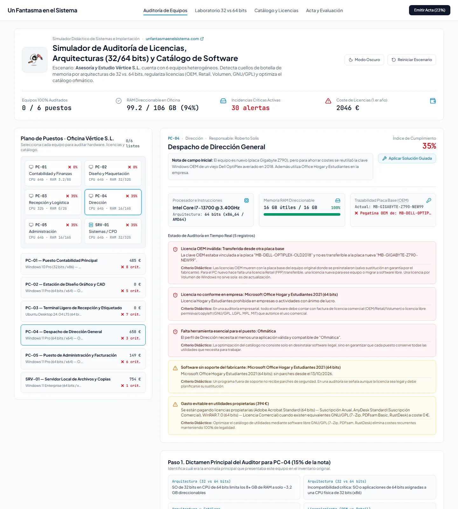
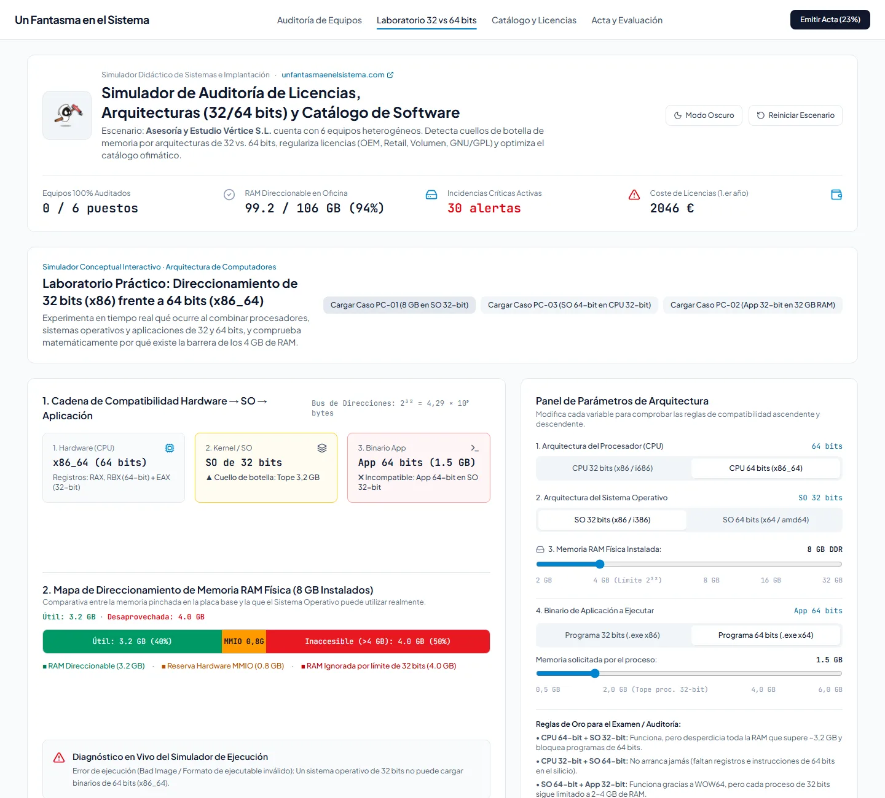
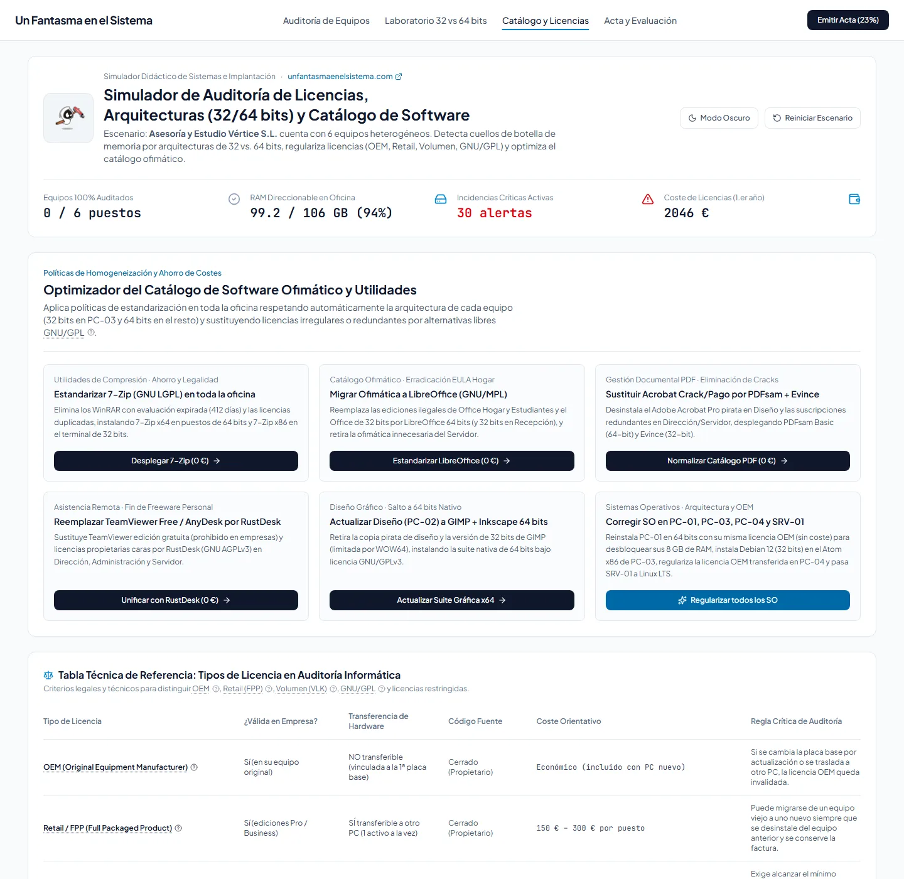
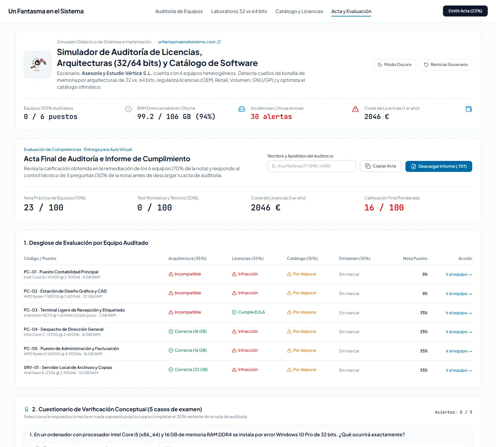

<p align="center">
  <a href="https://www.unfantasmaenelsistema.com"></a>
</p>

<h1 align="center">Simulador de Auditoría de Licencias y Compatibilidad</h1>

<p align="center">
  <b>Audita los seis equipos de una oficina: arquitectura de 32 o 64 bits, licencias de software y catálogo de programas</b><br>
  OEM, Retail, Volumen y suscripción · Software libre frente a freeware · Barrera de los 4 GB · WOW64 · Software sin soporte · Acta de auditoría
</p>

<p align="center">
  <a href="https://unfantasmaenelsistema.github.io/Simulador-Auditoria-Licencias-y-Compatibilidad/"><b>▶ Abrir el simulador</b></a> ·
  <a href="#qué-hace">Qué hace</a> ·
  <a href="#los-6-equipos">Los 6 equipos</a> ·
  <a href="#qué-modela-y-qué-no">Qué modela</a> ·
  <a href="#desarrollo">Desarrollo</a> ·
  <a href="https://www.unfantasmaenelsistema.com">unfantasmaenelsistema.com</a> ·
  <a href="LICENSE">MIT</a>
</p>

<p align="center">
  
  
  
  
</p>

<p align="center">
  
</p>

La asesoría ficticia Vértice S.L. tiene seis equipos con problemas reales de inventario: un Windows de 32 bits que solo ve 3,2 GB de sus 8 GB, una imagen de 64 bits que no arranca en un Atom de 32 bits, una licencia OEM reutilizada de un PC desechado, Office Hogar y Estudiantes en la oficina, cracks y programas de prueba caducados. Cambias el sistema operativo y los programas de cada puesto, emites un diagnóstico y el motor evalúa en tiempo real arquitectura, licencias, catálogo y coste.

> [!NOTE]
> Es un escenario didáctico. Los precios son orientativos y las reglas de licencia están simplificadas (cada fabricante tiene su contrato). El programa contable «ContaGest» es ficticio.

## Qué hace

- **Auditoría de equipos**: hardware de cada puesto (CPU, RAM, placa base y la pegatina OEM), selector de sistema operativo, programas instalados, hallazgos clasificados por gravedad con su regla didáctica, diagnóstico del auditor y solución guiada.
- **Laboratorio de 32 frente a 64 bits**: combina CPU, sistema operativo, RAM y aplicación y comprueba qué arranca, cuánta memoria se aprovecha (con el hueco de MMIO bajo los 4 GB) y cuándo un proceso de 32 bits se queda sin memoria.
- **Catálogo y licencias**: tabla comparativa de OEM, Retail, Volumen, suscripción, software libre, Hogar y Estudiantes y freeware, con acciones globales para estandarizar el catálogo con alternativas libres.
- **Acta y evaluación**: nota de la remediación (70 %) y de un control de cinco preguntas (30 %), con acta descargable en texto.
- El trabajo se guarda en el navegador y se puede reiniciar el escenario cuando se quiera.

<p align="center">
  
</p>

## Los 6 equipos

| Equipo | Problema | Solución guiada |
| :-- | :-- | :-- |
| PC-01 · Contabilidad | Windows 10 Pro de 32 bits (sin soporte) en un i5 con 8 GB: solo 3,2 GB útiles y el programa contable de 64 bits no arranca | Windows 11 Pro de 64 bits con **la misma licencia OEM del equipo** (sin coste) y catálogo en 64 bits |
| PC-02 · Diseño | GIMP de 32 bits en una estación de 32 GB y programas activados con crack | GIMP + Inkscape de 64 bits y utilidades libres |
| PC-03 · Recepción | Ubuntu 24.04 de 64 bits en un Atom N270 de 32 bits: no arranca | Debian 12 i386, la última versión de Debian con instalador de 32 bits |
| PC-04 · Dirección | Clave OEM de un Dell de 2018 en una placa nueva y Office Hogar y Estudiantes | Windows 11 Pro Retail y LibreOffice |
| PC-05 · Administración | Office Hogar y Estudiantes, TeamViewer Free y WinRAR caducado | LibreOffice, RustDesk y 7-Zip |
| SRV-01 · Servidor | Windows 11 Enterprise por Volumen sin licencia base, usado como servidor de archivos, con suites de oficina innecesarias | Ubuntu 24.04 LTS (libre, sin límite de conexiones) con solo lo necesario |

Las pruebas automáticas aplican la solución guiada a los seis equipos y comprueban que todos quedan al 100 % y sin hallazgos, con un coste total de 375 € (el programa contable y la licencia Retail del PC-04).

<p align="center">
  
</p>

## Qué modela y qué no

- **Una licencia de Windows vale para 32 y 64 bits.** Pasar de 32 a 64 bits es reinstalar con la misma licencia, y la licencia OEM de Windows Pro de un equipo admite la actualización gratuita a Windows 11 Pro.
- **OEM** muere con la placa base original (salvo sustitución en garantía); **Retail** se puede trasladar a otro PC; **Volumen** para Windows de escritorio es una licencia de actualización que exige una licencia Pro previa y un acuerdo con un mínimo habitual de 5 licencias.
- Un **Windows de escritorio** admite como máximo 20 conexiones entrantes para compartir archivos: no sustituye a un servidor.
- El **software libre** (GPL, LGPL, AGPL, MPL) permite el uso comercial; el **freeware personal** (TeamViewer Free) y las ediciones **Hogar y Estudiantes** no. Una **suscripción** es legal mientras se pague.
- Se señala el software **sin soporte del fabricante**: Windows 10 y Office 2019 desde el 14/10/2025, Office 2021 desde el 13/10/2026.
- Un proceso de 32 bits dispone de 2 GB por defecto (hasta 4 GB en un sistema de 64 bits si es LARGEADDRESSAWARE).
- No modela auditorías de fabricantes concretas, cuentas de usuarios de suscripción ni licencias de acceso de cliente (CAL).

<p align="center">
  
</p>

## Privacidad

Todo se ejecuta en el navegador, sin servidor ni cuentas. El escenario y el diagnóstico se guardan en el almacenamiento local del navegador. Las fuentes van incluidas en la web y una política CSP estricta impide cargar código o estilos de terceros.

## Desarrollo

Requisitos: Node.js 20 o superior.

```bash
git clone https://github.com/unfantasmaenelsistema/Simulador-Auditoria-Licencias-y-Compatibilidad.git
cd Simulador-Auditoria-Licencias-y-Compatibilidad
npm ci
npm run dev      # http://localhost:3000
npm test         # pruebas del motor de auditoría (Vitest)
npm run lint     # comprobación de tipos
npm run build    # versión estática en dist/
```

El workflow `.github/workflows/deploy.yml` comprueba tipos, pasa las pruebas, compila y publica `dist/` en GitHub Pages en cada push a `main`.

```text
src/
├── data/auditScenario.ts       # catálogo de SO y programas, los 6 equipos, solución guiada y motor de evaluación
├── data/auditScenario.test.ts  # pruebas (Vitest)
└── components/                 # auditoría, laboratorio 32/64 bits, catálogo, acta y fichas de licencia
```

## Cambios

### 2.0.0 (2026-11-02)

- Publicado en la organización con despliegue en GitHub Pages: el workflow original no podía funcionar (`npm install` fallaba por un conflicto de versiones de `esbuild`).
- **Licencias de Windows**: el simulador enseñaba que pasar el PC-01 de 32 a 64 bits obligaba a comprar otra licencia, y la solución guiada lo migraba a Ubuntu y le cambiaba el programa contable a la usuaria. Ahora reinstala Windows 11 Pro de 64 bits con su propia licencia OEM, sin coste, y conserva su programa. El coste del sistema operativo dependía de una excepción escrita a mano para dos equipos concretos.
- **Volumen**: se presentaba como alternativa para trasladar una licencia a otro PC; en Windows de escritorio es una licencia de actualización. El servidor ahora avisa de que su Enterprise no tiene licencia base y de que un Windows de escritorio no sirve como servidor de archivos.
- **Catálogo**: suscripciones (Adobe, AnyDesk, el programa contable) clasificadas como Retail; un «activador KMS» para Adobe (KMS es de Microsoft); LibreOffice 24.2 de 32 bits para Debian, que no existe (Debian 12 trae la 7.4); un programa contable con el nombre de un producto real, ahora ficticio. Nuevo aviso de software sin soporte (Windows 10, Office 2019 y 2021).
- **Arquitectura**: el aviso de RAM no saltaba con 4 GB justos, aunque se pierden ~0,8 GB; el límite de memoria de un proceso de 32 bits en un sistema de 64 bits estaba mal explicado.
- **Interfaz**: el indicador «Presupuesto anual» sumaba compras únicas y suscripciones; la cabecera desbordaba en móvil; un estado guardado dañado se cargaba sin validar y reiniciar no pedía confirmación. Fuentes incluidas en la web en lugar de Google Fonts, CSP estricta, capturas reales en lugar de dibujos SVG, fuera dependencias de Gemini y Express que no se usaban, y 15 pruebas automáticas.

### 1.0.0

- Versión inicial generada con Google AI Studio.

## Créditos y licencia

Creado por **[Un Fantasma en el Sistema](https://www.unfantasmaenelsistema.com)** para los módulos de sistemas operativos, implantación y seguridad informática de FP. Fuentes Plus Jakarta Sans y JetBrains Mono (SIL Open Font License) vía Fontsource; iconos de Lucide (ISC). Las marcas comerciales citadas pertenecen a sus propietarios.

Código bajo licencia [MIT](LICENSE).
